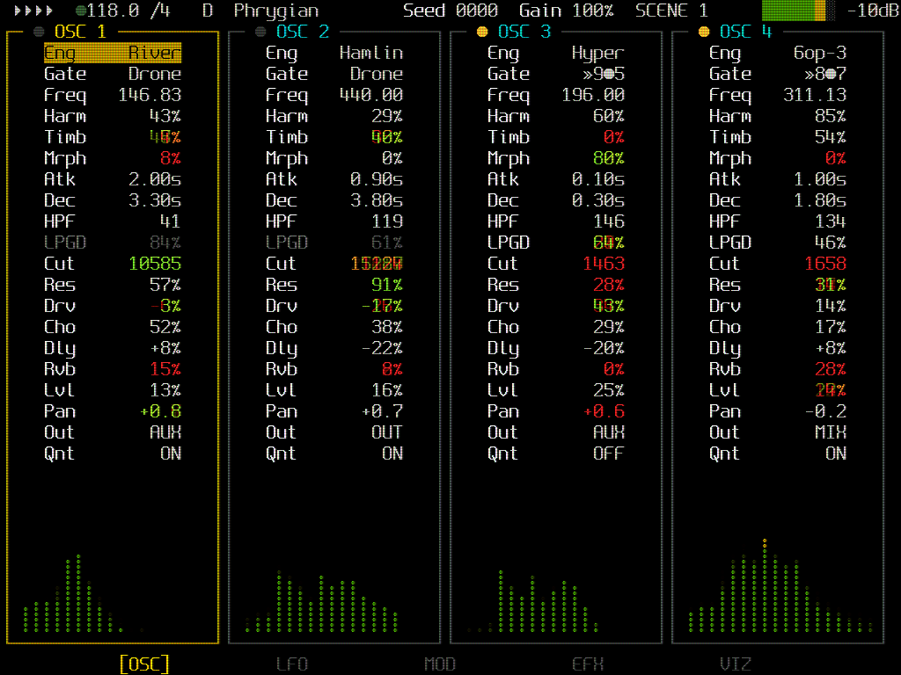
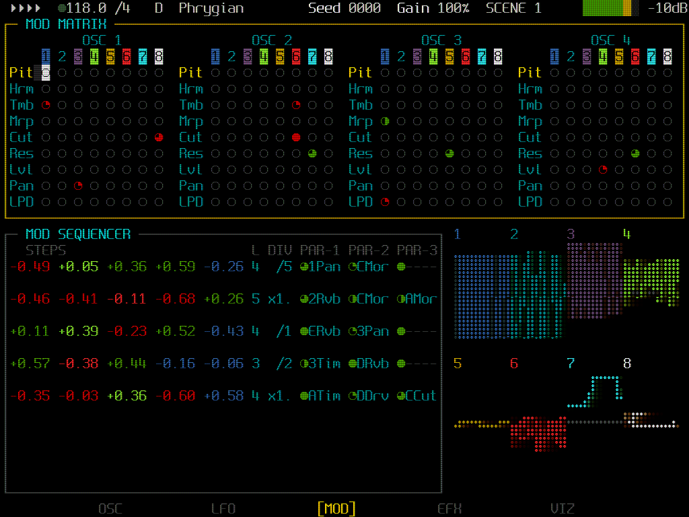
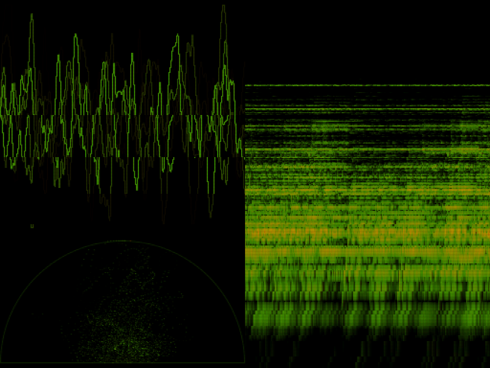

# Dronage Zero

Dronage Zero is an ambient drone workstation for the TrimUI Brick (NextUI),
with 4 oscillators, a mod matrix with 8 LFOs and rich effects such as a
granular delay and a shimmer reverb.

It is the "eye-friendly" version of
[Dronage Terminal](https://github.com/boorch/dronage-terminal-pak): the same
instrument on five full-screen views with large text. The two share one
project format, so a project saved in either opens in the other.

## Install

From the Pak Store: find **Dronage Zero** under Tools.

By hand: download `Dronage.Zero.pak.zip` from the latest release, unzip it into a folder named
`Dronage Zero.pak`, and copy that folder to `Tools/tg5040` on the SD card.

## Use

L4 and R4 switch between the five views. Hold South (B) and press the d-pad to
change a value. Menu opens the menu. **R1 + Select shows every control.**

Projects, recordings, themes and user scales are kept in `DronageZero` at the
root of the SD card.

Licence: [EULA.txt](EULA.txt) and
[THIRD-PARTY-LICENSES.txt](THIRD-PARTY-LICENSES.txt).
